# Task A: Road damage detection — talk script

About **7 minutes** (~960 spoken words at ~140 words per minute).
**Say** is meant to be spoken. **On screen** is what to show while saying it.
> Notes in quote blocks like this are for us, not for saying aloud.

| # | Section | Time |
|---|---|---|
| 1 | [Background and motivation](#1-background-and-motivation-30-s) | 0:00 – 0:30 |
| 2 | [Approach and strategy](#2-approach-and-strategy-35-s) | 0:30 – 1:05 |
| 3 | [Data analysis](#3-data-analysis-1-min-25-s) | 1:05 – 2:30 |
| 4 | [Methods and models](#4-methods-and-models-40-s) | 2:30 – 3:10 |
| 5 | [Results](#5-results-1-min-15-s) | 3:10 – 4:25 |
| 6 | [Discussion](#6-discussion-1-min-15-s) | 4:25 – 5:40 |
| 7 | [Sustainability](#7-sustainability-45-s) | 5:40 – 6:25 |
| 8 | [Key learnings](#8-key-learnings-25-s) | 6:25 – 6:50 |

---

## 1. Background and motivation (~30 s)

**Say**

Roads have to be inspected continuously, and today much of that is done manually, which is slow and expensive. Our customer, a Norwegian road organisation, wants to know whether cameras and deep learning can automate it.

My part is **object detection**: finding four types of damage with bounding boxes — longitudinal cracks, transverse cracks, alligator cracking and potholes. I trained on RDD2022 and also evaluated on the customer's own Norwegian Road Damage dataset.

**On screen**

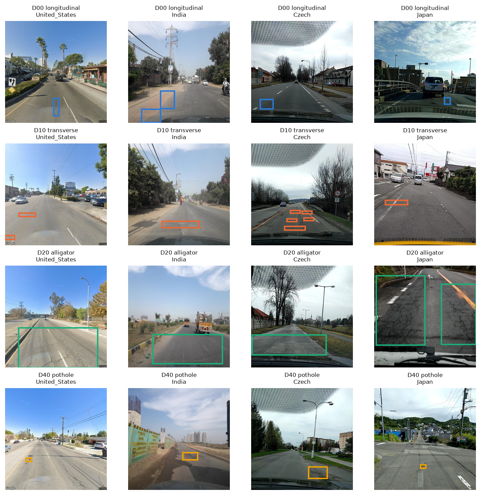
*The four classes (D00, D10, D20, D40) in images from different countries.*

---

## 2. Approach and strategy (~35 s)

**Say**

My strategy was **data first**. Before training anything, I analysed the data and used what I found to choose the experiments.

Then I trained a baseline and changed **one thing at a time**: first the architecture, then the input resolution. Every model got the same evaluation — overall, per country, on the customer's data, and an error analysis that sorts every ground-truth box into found, missed or boxed differently. Every decision is logged with its reasoning, so the work is reproducible.

**On screen**

| Step | Question |
|---|---|
| Data analysis | What makes this data hard? |
| Baseline: YOLO11s @ 640 | Reference point |
| YOLO26s @ 640 | Is the architecture the bottleneck? |
| YOLO11s @ 1280 | Is resolution the bottleneck? |
| Same evaluation for all | Overall · per country · customer data · error types |

---

## 3. Data analysis (~1 min 25 s)

**Say**

RDD2022 has about 38,000 labelled images from seven sources. I kept the four target classes and dropped about ten thousand boxes with other labels, such as faded road markings and manholes, which aren't damage. I left out the Chinese drone subset, because it's a top-down view, unlike the customer's dashcam video. The official test labels were never released, so I made my own 80/10/10 split per country.

Three findings shaped everything after that.

**First, the countries are very different.** Norway is 76% longitudinal cracks, India is mostly potholes, Japan mostly alligator cracking. One overall number hides a lot, so I report results per country.

**Second — and this became the main story — image size.** Norway's images are about 4,000 pixels wide, roughly six times larger than the others. At YOLO's default input of 640 pixels, half of Norway's boxes shrink below 16 pixels, and almost a quarter below 8. Thin cracks almost disappear.

**Third, box shape practically defines the class.** Longitudinal cracks give tall boxes, transverse cracks give wide ones. A vertical flip or rotation would silently turn one class into the other, so I checked that the augmentation only uses horizontal flips.

**On screen**

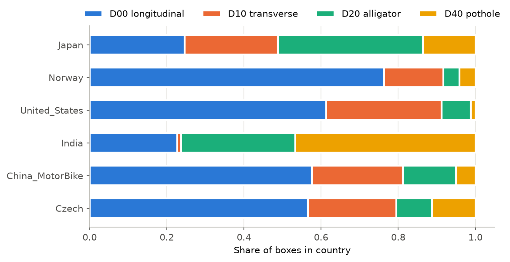
*Finding 1: class mix per country.*

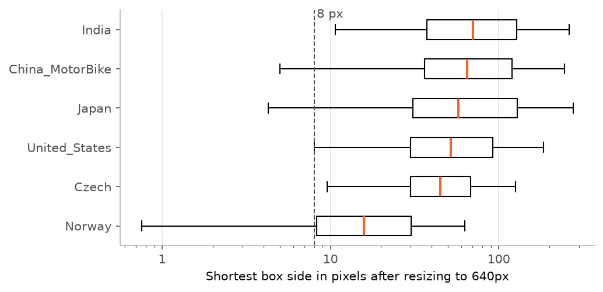
*Finding 2: Norway's boxes become tiny at 640 px (23.5% under 8 px; 0–0.3% elsewhere).*

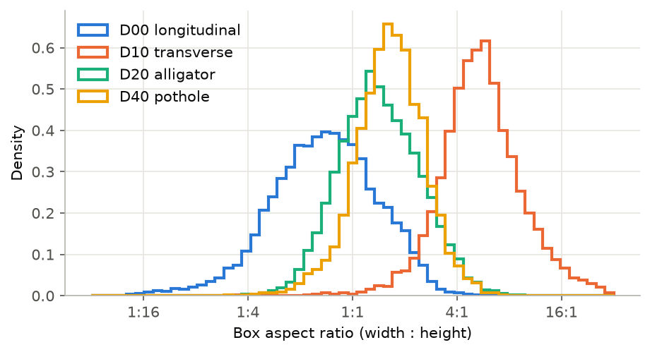
*Finding 3: D00 is tall, D10 is wide — vertical flips/rotations would corrupt labels.*

---

## 4. Methods and models (~40 s)

**Say**

As the baseline I fine-tuned **YOLO11s** from COCO weights with Ultralytics. It's a fast, well-documented one-stage detector, and the small size fits the GPU budget. On top of the defaults I used early stopping, a fixed seed, and logging of the GPU's power draw.

Then two experiments, each changing one thing. **YOLO26**, released this year, is NMS-free and claims better small-object detection — it tests whether the architecture is the bottleneck. And **YOLO11s at 1280 pixels** tests the resolution hypothesis from the data analysis. All runs were trained on A100 GPUs on IDUN.

**On screen**

| Run | Change | Epochs (best) | Training |
|---|---|---:|---:|
| YOLO11s @ 640 | Baseline | 96 (76) | 2.5 h |
| YOLO26s @ 640 | Architecture | 94 (74) | 2.9 h |
| YOLO11s @ 1280 | Resolution (batch 16 instead of 32) | 91 (71) | 7.8 h |

> If asked: early stopping with patience 20; horizontal flip only; mosaic off for the last 10 epochs; the 1280 run used batch 16 to fit memory, which is a second difference from the baseline.

---

## 5. Results (~1 min 15 s)

**Say**

Overall on the test split, all three models land at about **0.60 mAP50** and 0.30 mAP50-95. YOLO26 is about one point higher, but with one run per model that's within normal run-to-run variation.

The per-country picture is where it gets interesting. At 640 pixels, Norway is the weakest country, at 0.28, and YOLO26 doesn't change that. At 1280, **Norway rises to 0.37** — about 30% better — and on the customer's dataset, mAP50 goes from **0.21 to 0.32**, about 50% better. Meanwhile, countries with small source images gain nothing or lose a little, which is why the overall number stays flat.

The error analysis shows why. Here every ground-truth box is measured at the same scale for all three models. In Norway, the 1280 model finds more boxes at every size — for the smallest ones, about four times as many. In the other countries, the lines lie on top of each other. And across all models, the dominant error is **missed damage**; a wrong class is only one to two percent.

**On screen**

| Model | mAP50 all | mAP50-95 all | mAP50 Norway | mAP50 NRD (customer) |
|---|---:|---:|---:|---:|
| YOLO11s @ 640 | 0.596 | 0.304 | 0.284 | 0.208 |
| YOLO26s @ 640 | 0.607 | 0.310 | 0.294 | 0.202 |
| YOLO11s @ 1280 | 0.599 | 0.291 | **0.370** | **0.317** |

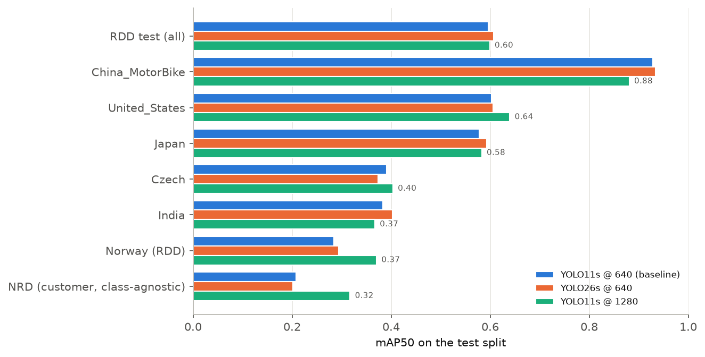
*mAP50 per set. Point at Norway and NRD (bottom two rows).*

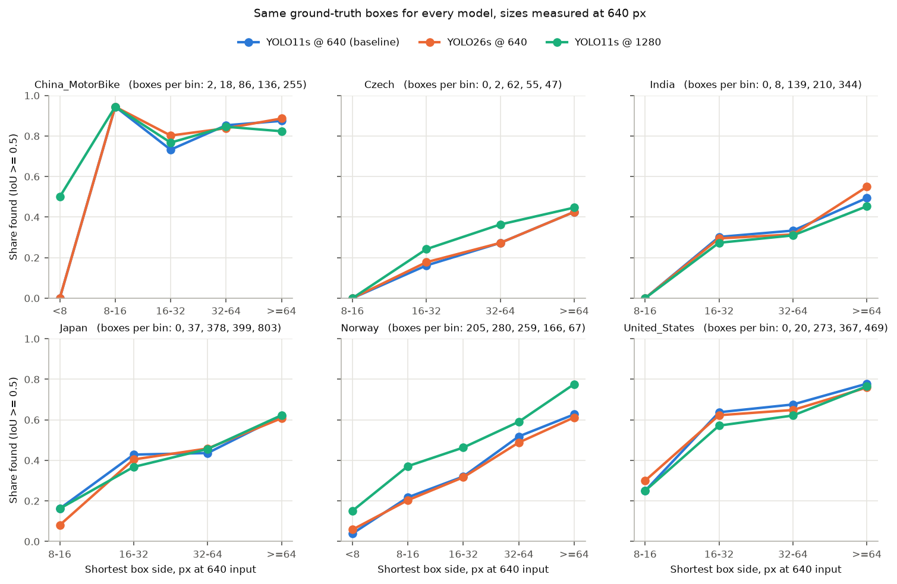
*Same boxes for every model. Only Norway's panel shows the green 1280 line clearly above.*

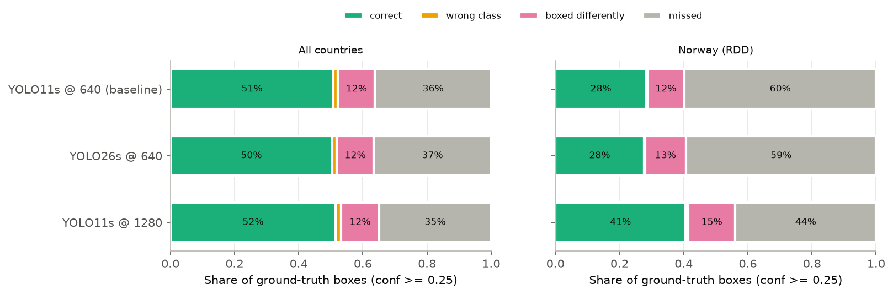
*Missed dominates; 1280 cuts Norway's missed share from 60% to 44%.*

---

## 6. Discussion (~1 min 15 s)

**Say**

So the main limitation isn't the model, it's the **data**: object size, domain and annotation style. Norway often labels one long crack as many small boxes, while the US uses one box per crack. No model can match both conventions, which also helps explain the low mAP50-95.

On the customer's data, the model is **under-confident**. At the default threshold, the baseline made only 15 predictions across 50 images, and 90 of the 109 damages had no overlapping prediction at all. It's a different domain — another camera, early spring, the dashboard covering a quarter of the frame — and with only 109 boxes, the uncertainty is large.

I also checked for **leakage**, because China_MotorBike scores suspiciously high. Perceptual hashing found under 2% near-identical images between train and test. But the example images show the same spot photographed from slightly different positions, which hashing can't catch, so its 0.93 should be read with caution.

Improvements: tile only the high-resolution Norwegian images instead of upscaling everything, and choose a lower confidence threshold for the customer.

**On screen**

| Norway @ 640 | Norway @ 1280 |
|---|---|
|  | 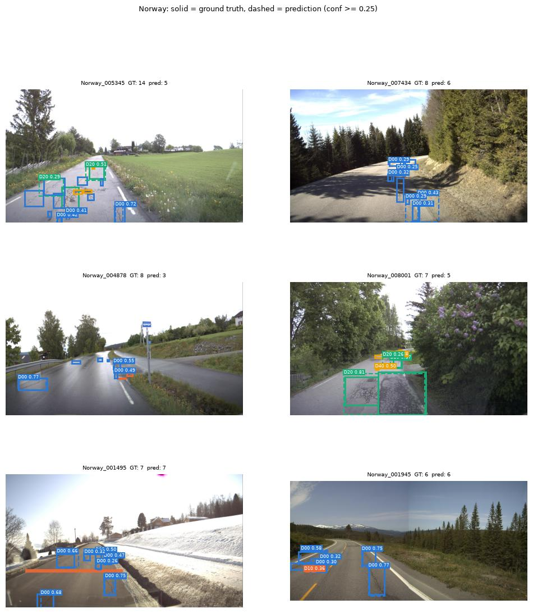 |

*Same images at both resolutions. E.g. Norway_007434: 8 small boxes on one crack.*

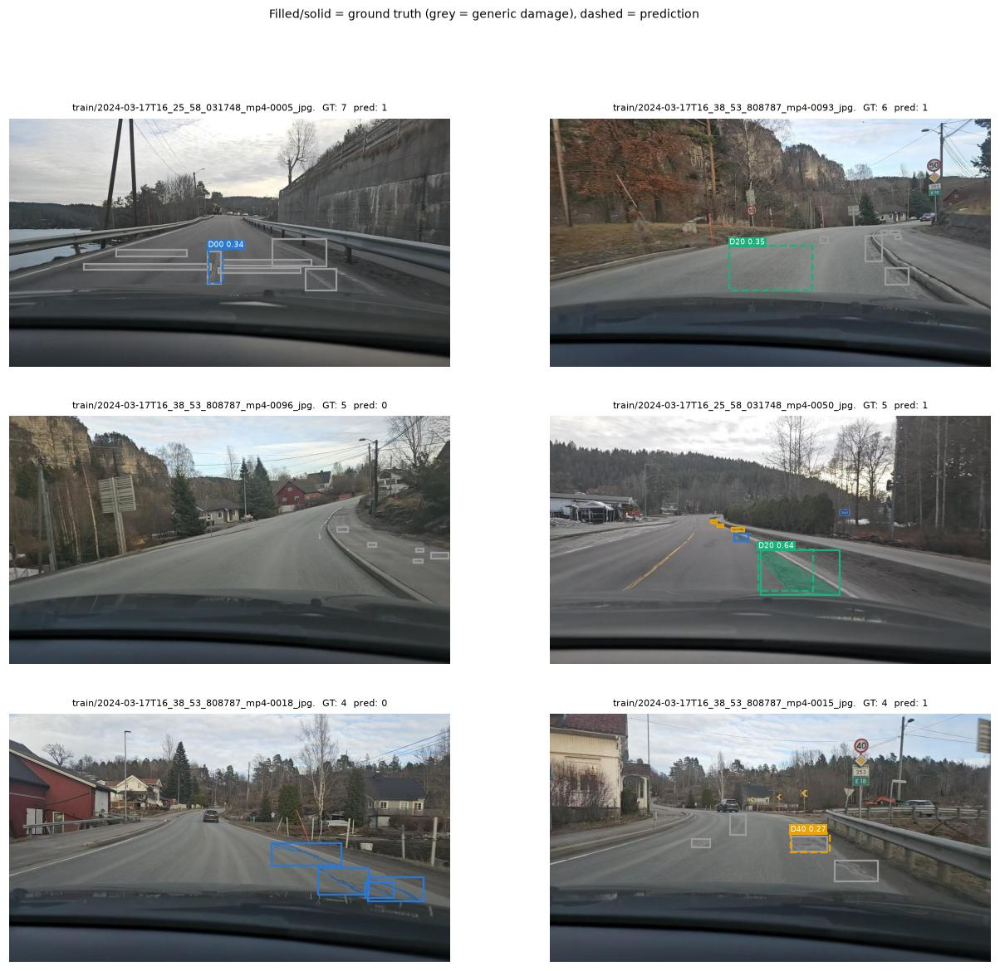
*Customer data (NRD): grey = generic damage labels, dashed = predictions. Few predictions.*

| China_MotorBike examples | Hash distance to nearest train image |
|---|---|
| 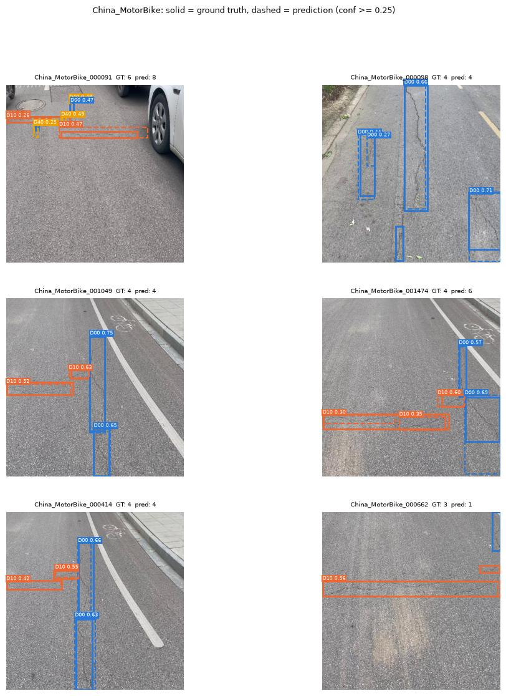 | 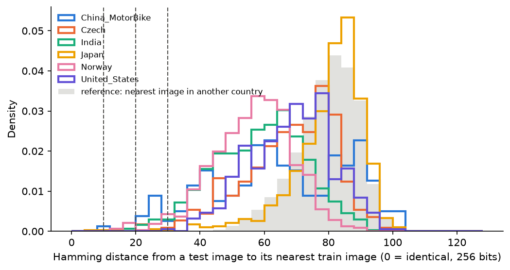 |

*Left: close-up camera; 000414, 001049 and 001474 show the same spot. Right: grey = reference from other countries.*

> The leakage sentence may need adjusting after we look at the closest duplicate pairs (`results/duplicates/pairs_closest_China_MotorBike.jpg`).

---

## 7. Sustainability (~45 s)

**Say**

I logged the GPU's power for every job. The three training runs used **2.8 kilowatt-hours** in total — about 16 kilometres in an electric car. The 1280 model alone used 1.7: three and a half times the baseline, and it's about three times slower at inference, though still around 150 images per second.

Overall it buys nothing, but for Norwegian data it's the only thing that helped. So my recommendation is to spend the extra compute **only where the images actually have more detail**. And the training curves flatten after about 50 epochs, so roughly half the energy could be saved for one or two points of mAP.

**On screen**

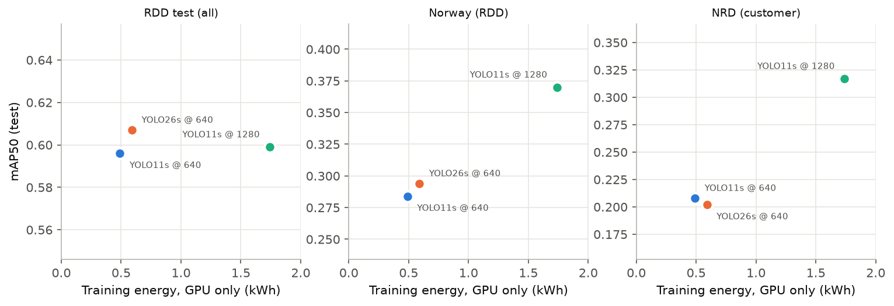
*Left: no gain overall for 3.5× energy. Middle/right: the gain is all in Norwegian data.*

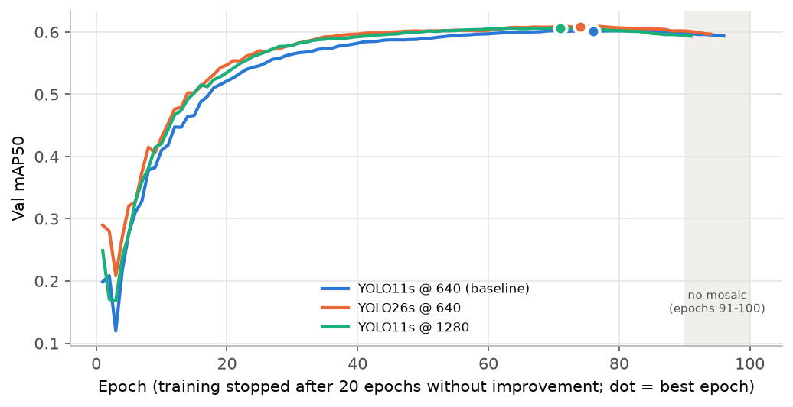
*Curves are nearly flat after epoch ~40–50.*

> GPU only (CPU, RAM and cooling not included); CPU jobs and failed jobs not measured. Say this if asked.

---

## 8. Key learnings (~25 s)

**Say**

Three things I take away. Analyse the data before choosing models — here, the data analysis predicted the main result. Change one thing at a time, and look beyond a single overall number, because the average hid the most important effect. And a newer architecture isn't automatically better — measuring that was worth more than assuming it.

> Contributions and references are shared with the segmentation part. Detection references: RDD2022 paper, Ultralytics YOLO11/YOLO26, the NorwegianRoadDamage Roboflow dataset (CC BY 4.0).
