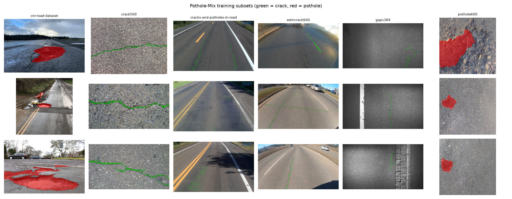
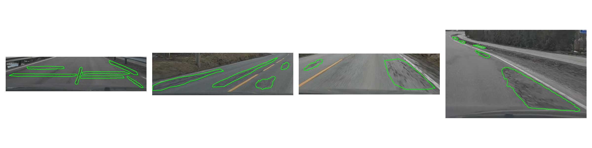
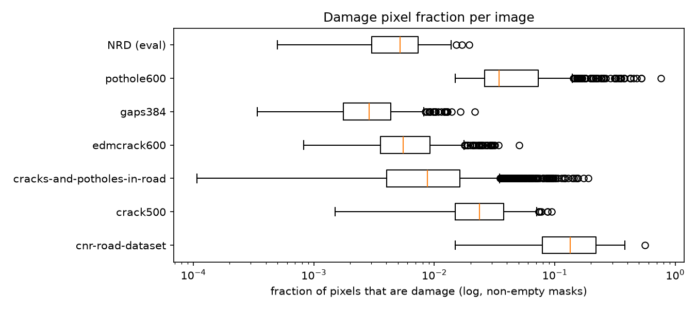
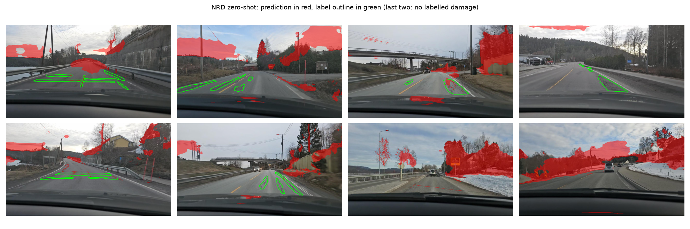
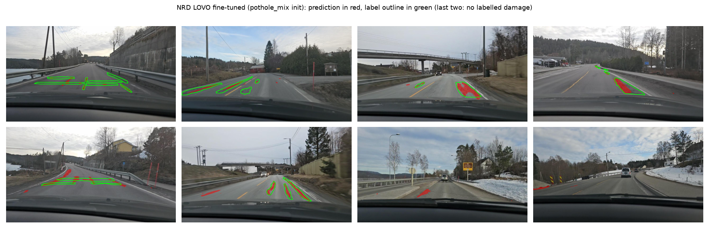

# Task B: Road damage segmentation — talk script

About **6.5 minutes** (~900 spoken words at ~140 words per minute), so detection + segmentation fit in 14 minutes.
**Say** is meant to be spoken. **On screen** is what to show while saying it.
> Notes in quote blocks like this are for us, not for saying aloud. **TODO** marks numbers still running.

| # | Section | Time |
|---|---|---|
| 1 | Background and motivation | 0:00 – 0:25 |
| 2 | Approach and strategy | 0:25 – 0:55 |
| 3 | Data analysis | 0:55 – 2:05 |
| 4 | Methods and models | 2:05 – 2:50 |
| 5 | Results | 2:50 – 4:20 |
| 6 | Discussion | 4:20 – 5:20 |
| 7 | Sustainability | 5:20 – 6:00 |
| 8 | Key learnings | 6:00 – 6:25 |

---

## 1. Background and motivation (~25 s)

**Say**

Boxes tell you *where* damage is. A pixel mask also tells you *how much*: the damaged area, which is what a maintenance planner needs to prioritise. My part is **semantic segmentation** of road damage, and the target is the customer's own data, Norwegian Road Damage.

**On screen**

*Pixel masks: cracks and potholes.*

---

## 2. Approach and strategy (~30 s)

**Say**

The customer's dataset has only 50 labelled images, so it is an **evaluation set**, not a training set. My plan: train on the public Pothole-Mix dataset, test how well that transfers to Norway with no Norwegian training at all, and then measure how much a little Norwegian data helps. Every model is compared on the same 50 images with the same metrics.

**On screen**

| Step | Question |
|---|---|
| Train on Pothole-Mix | Does public data transfer to Norway (zero-shot)? |
| U-Net vs SegFormer | CNN or transformer, same size? |
| Fine-tune on NRD, leave one video out | How much does a little Norwegian data help? |
| Stage 2 on RDD2022 Norway (boxes) | Can detection labels teach Norwegian roads? |

---

## 3. Data analysis (~1 min 10 s)

**Say**

Three findings shaped the method.

**First, the customer's split leaks.** The 50 Norwegian images are frames from only six videos, and every test video also appears in training. So I never used the official split. Instead I evaluate on all 50 images, and when I fine-tune, I hold out **one whole video at a time**.

**Second, the labels are a different kind.** Pothole-Mix has tight masks around each crack. The Norwegian labels are **loose polygons around whole damaged areas**, mostly with a generic "damage" class. That's why I chose **binary** segmentation, damage versus background.

**Third, damage is tiny.** In most images under 1% of pixels are damage, and thin cracks are one or two pixels wide. Shrinking to the usual 512 pixels would erase them, so I only downscale to 1024 and train on 512-pixel crops, and I use Dice plus cross-entropy loss, which copes with the class imbalance.

**On screen**

*NRD: loose polygons around damaged areas, not tight crack masks.*

*Damage is 0.1–3% of the pixels in most images (log scale).*

---

## 4. Methods and models (~45 s)

**Say**

I compared two architectures of the **same size**, about 25 million parameters: a **U-Net with a ResNet-34** encoder, a classic CNN, and **SegFormer-B2**, a transformer. Both start from ImageNet weights and are trained for 40 epochs.

Pothole-Mix doesn't look like Norway, so I also tried a **second training stage on RDD2022 Norway**, the detection data. It only has boxes, so I tried two ways to turn boxes into pixel labels: **filling the boxes**, which overstates the damage, and a **box projection loss**, where everything outside a box is background and each box must contain some damage, without saying which pixels.

**On screen**

| Model | Params | Training data |
|---|---:|---|
| U-Net + ResNet-34 | 24.4 M | Pothole-Mix |
| SegFormer-B2 | 24.7 M | Pothole-Mix |
| U-Net, stage 2 (filled boxes / projection loss) | 24.4 M | + RDD2022 Norway |

---

## 5. Results (~1 min 30 s)

**Say**

On the Pothole-Mix test set, both models reach about **0.55 IoU**; SegFormer is slightly ahead.

On the customer's data, **zero-shot fails completely**: IoU 0.003. The model marks sky, trees, snow and the car bonnet as damage. Pothole-Mix contains almost only road, so it never learned what is *not* road.

The second stage on Norwegian roads helps a lot: with filled boxes, IoU rises to **0.19** without a single customer image. The projection loss finds 84% of the damaged regions, but it marks about three times too much area, so its IoU is lower.

The biggest step is fine-tuning on the customer's own videos. Holding out one video at a time, IoU reaches **0.33**, stable over three seeds, and the off-road false positives disappear. Starting from Pothole-Mix or from plain ImageNet gives the same IoU, but Pothole-Mix gives higher precision and ImageNet higher recall.

**On screen**

| NRD, 50 images | IoU | Precision | Recall | Region recall |
|---|---:|---:|---:|---:|
| Zero-shot U-Net (Pothole-Mix) | 0.003 | 0.003 | 0.055 | 0.15 |
| Zero-shot, stage 2 filled boxes | 0.185 | 0.323 | 0.303 | 0.31 |
| Zero-shot, stage 2 projection loss | 0.065 | 0.082 | 0.233 | 0.84 |
| Fine-tuned U-Net, Pothole-Mix init (3 seeds) | **0.327 ± 0.007** | 0.589 | 0.424 | 0.67 |
| Fine-tuned U-Net, ImageNet init (3 seeds) | 0.314 ± 0.025 | 0.467 | 0.493 | 0.72 |
| Fine-tuned SegFormer, Pothole-Mix init (3 seeds) | 0.320 ± 0.010 | 0.539 | 0.441 | 0.61 |

> **TODO:** add the fine-tuned rows for the two stage-2 models (projection LOVO is running, filled-box LOVO not yet run). If stage 2 + fine-tuning beats 0.327, that becomes the headline.

*Zero-shot: red = prediction, green = label. Sky, trees and snow are marked as damage.*

*Fine-tuned, held-out video: predictions follow the damaged areas.*

---

## 6. Discussion (~1 min)

**Say**

The main lesson is **domain gap**. A model that scores 0.55 on public data scores almost zero on Norwegian dashcam video. Even 40 frames from other Norwegian videos fix most of it, and so do Norwegian detection boxes.

The metric is also limited by the labels. Loose polygons around a damaged area can't be matched pixel for pixel, so 0.33 IoU understates how useful the masks look. That's why I also report region recall: two thirds of the damaged areas are found.

Limitations: 50 images from six videos, all from one day in early spring, so the uncertainty is large. And box labels are a weak signal: filled boxes overstate the area, and the projection loss as I implemented it doesn't stop the model from over-predicting.

Improvements: label more Norwegian frames, or use the paper's approach of SAM-3 pseudo-labels turned into masks.

---

## 7. Sustainability (~40 s)

**Say**

I logged GPU power for every run. Each stage-1 model used under 0.12 kilowatt-hours; the three Pothole-Mix runs together used about **0.28 kWh**, roughly **1.5 km in an electric car**. Fine-tuning on the customer's data takes about 7 minutes per seed.

At inference, the U-Net needs about **12 ms per image** on an A100 and 4 ms on an RTX 5090. The paper's SAM-3 pipeline has 473 million parameters and needs 457 ms per image, about 20 times the size and 40 times slower. SegFormer was no better than U-Net but used more energy, so I recommend the **U-Net**.

**On screen**

| Run | GPU energy | |
|---|---:|---|
| U-Net stage 1 | 0.071 kWh | |
| SegFormer-B2 stage 1 | 0.119 kWh | +68% for no NRD gain |
| U-Net long run | 0.085 kWh | |
| Inference: U-Net vs SAM-3 pipeline | 12 ms vs 457 ms / image | 24 M vs 473 M params |

> GPU only, A100 on IDUN. **TODO:** add stage-2 and LOVO energy (5090 runs have power logs in `logs/`). EV figure uses ~0.18 kWh/km, the same factor as the detection part.

---

## 8. Key learnings (~25 s)

**Say**

Three takeaways. A good score on public data says little about the customer's data: always evaluate on the target domain, with a split that doesn't leak. Look at the labels, not just the images: the annotation style decided the task and the metric. And a small amount of in-domain data beat every architectural choice I tried.

> Contributions: Kristoffer = segmentation, Victor = detection; shared intro and conclusion.
> Segmentation references: Pothole-Mix (Mendeley Data, kfth5g2xk3); Norwegian Road Damage (Roboflow, CC BY 4.0); Shami et al. 2026 (the background paper); Ronneberger et al. 2015 (U-Net); Xie et al. 2021 (SegFormer); Tian et al. 2021 (BoxInst, projection loss); segmentation-models-pytorch.
